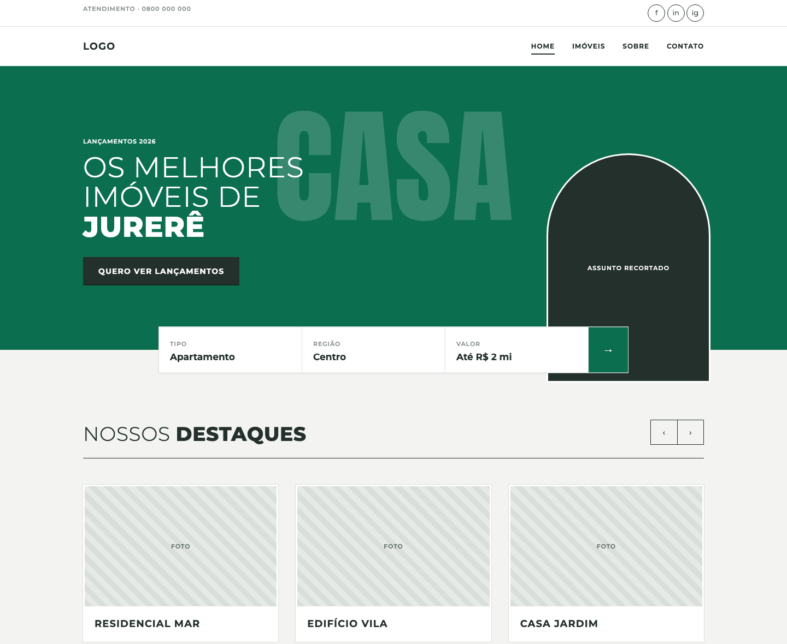
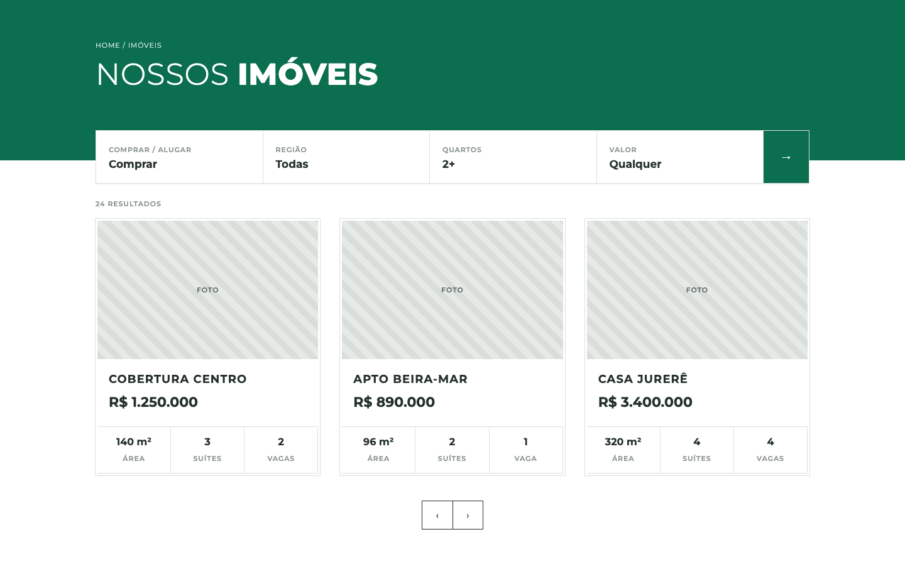
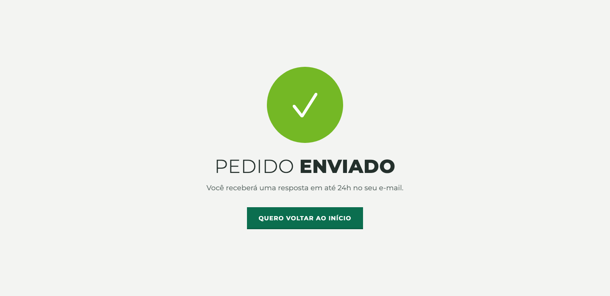
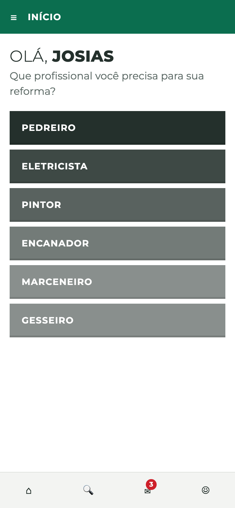
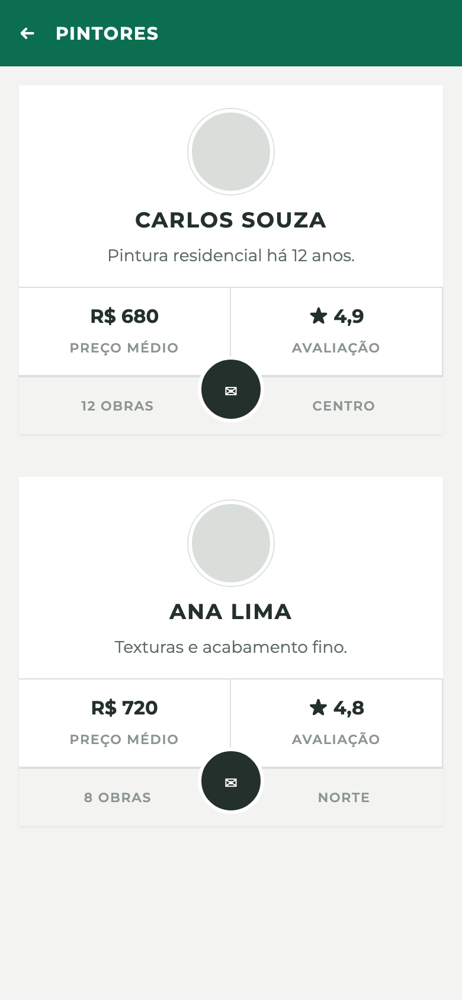

# bitnix-ui

Skill de design system (Bitnix) para o Claude. Em vez de redesenhar cada tela do zero, o Claude parte de uma gramática visual única e de uma folha de componentes em CSS, e monta qualquer site ou app a partir dela.

## O que é

Um design system em três camadas:

1. **Fundamentos:** regras que valem em qualquer tela (grid rígido com quebra controlada, caixa alta com peso misto, acabamento em linha, cantos retos, foto real, voz de interface).
2. **Componentes:** peças prontas em CSS (prefixo `bx-`): botões, campos, busca segmentada, abas, cards, pares de dado, app bar, tab bar, escada tonal, listas, rodapé.
3. **Catálogo de páginas:** oito famílias que cobrem qualquer página ou tela, cada uma com receita e nível de expressão.

A **cor não faz parte do estilo**: vem da marca do cliente. Troca-se só o bloco `--brand` / `--ink` e o resto se mantém.

## O que ela faz

Quando você pede uma página ou tela, o Claude:

1. identifica a **família** da página, a plataforma (site ou app) e o nível de expressão;
2. confirma a **marca** (cor, fonte, logo);
3. monta pela **receita da família**, usando só componentes da folha comum;
4. entrega em **HTML/CSS, React ou imagem estática** e confere com um checklist.

### As oito famílias

| Família | Exemplos |
|---|---|
| A. Vitrine | home, landing, lançamento, onboarding de app |
| B. Listagem | catálogo, resultado de busca, blog, lista de profissionais |
| C. Detalhe | produto, imóvel, curso, perfil, artigo |
| D. Institucional | sobre, método, serviços, carreiras |
| E. Conversão | contato, orçamento, planos e preços, login, pagamento |
| F. Retorno e estado | obrigado, 404, estado vazio, manutenção |
| G. Área logada | dashboard, pedidos, mensagens, perfil |
| H. Suporte | FAQ, central de ajuda, termos, comparador |

### Regra de copy: CTA em primeira pessoa

Botões de decisão falam na voz do usuário: **QUERO ME INSCREVER**, não INSCREVA-SE. Quando a decisão parece do usuário, e não uma oferta empurrada, a objeção cai.

## Exemplos do que dá para fazer

Telas geradas só com a folha de componentes da skill (fotos e pessoas são placeholders).

### Vitrine (site, expressão alta)
Hero em camadas: palavra-objeto gigante, assunto recortado transbordando, busca segmentada cavalgando a divisória entre hero e seção.



### Listagem (site, expressão média)
Header de marca com a busca subindo sobre ele, cards emoldurados com pares de dado e paginação em setas.



### Conversão: planos e preços
Plano recomendado em `--on-brand`, maior, cavalgando a linha dos outros. CTAs em primeira pessoa.


### Retorno e estado: confirmação
Círculo grande com ícone de linha, título em caixa alta com peso misto, promessa concreta e uma única ação.



### App: home com escada tonal
Saudação com nome em bold, pergunta direta, categorias na escada tonal (mesma matiz clareando) e tab bar com badge.



### App: lista de profissionais
Avatar, pares de dado, e botão circular cavalgando a divisória do rodapé do card.



## Versões

Versão atual: **1.1.0**. Veja o [histórico de versões](CHANGELOG.md) e as [releases](https://github.com/josias-oliveira/bitnix-ui/releases).

A v1.1 ampliou o repertório (mais de 25 componentes novos, receitas de catálogo B2B, e-commerce, portfólio, contato e cadastro longo) e incluiu uma memória técnica com medidas de grid, tipografia e cor extraídas de sete referências (seção 8 do `SKILL.md`).

## Instalação

```bash
git clone https://github.com/josias-oliveira/bitnix-ui
mkdir -p ~/.claude/skills && cp -R bitnix-ui/bitnix-ui ~/.claude/skills/
```
